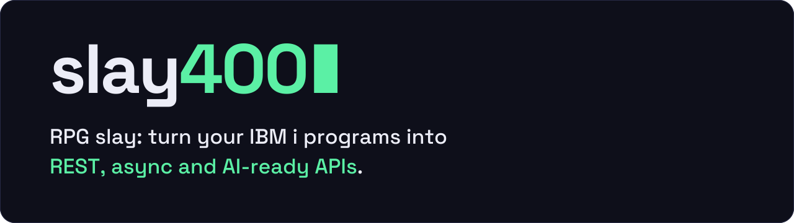

  

slay400 turns RPG programs on IBM i (AS/400) into managed APIs, straight from the PCML your compiler already produces. No rewrite, no hand-written wrappers: the program stays where it is and as it is.

## How it works

1. **Describe.** The RPG compiler emits PCML, an XML description of your program's parameters. That file is the call contract, and slay400 never asks you to edit it.
2. **Shape.** A small overlay file next to the PCML says which parameters go in, which come out, and what they are called in the API. It lives in Git and is reviewed like code.
3. **Serve.** A pull request validates the contract, compares it with the released version and tests it against a mock. The result is a versioned bundle with an OpenAPI document, served by the gateway.

## Repositories

The code lives in the [generativearchitects-ai](https://github.com/generativearchitects-ai) organisation.

| Repository | What it is | Licence |
|---|---|---|
| [slay400-core](https://github.com/generativearchitects-ai/slay400-core) | The generator: PCML parser, overlay, validation, codec, OpenAPI and descriptor emitters, command-line tool, Maven plugin | Apache-2.0, open source |
| [slay400](https://github.com/generativearchitects-ai/slay400) | The gateway runtime, Community Edition | BSL 1.1, source-available |
| [slay400-website](https://github.com/generativearchitects-ai/slay400-website) | The site at [slay400.dev](https://slay400.dev) | Not open source |

## Status

Early development. The generator comes first and the gateway follows. Nothing here is ready for production yet; watch the repositories to follow releases.

## Editions

- **Community Edition.** Free for companies under EUR 1 million in annual revenue, production included, and for everyone to develop, test and evaluate.
- **Enterprise.** For larger companies and more complex architectures: authentication and claims, cache, asynchronous request-reply, events over Pub/Sub, and an MCP server so AI agents can call your APIs.
- **SaaS.** The same, fully managed. Planned.

## Learn more

- [slay400.dev](https://slay400.dev): what it is and how it works
- [For architects](https://slay400.dev/architects/): integration before and after, with diagrams
- [FAQ](https://slay400.dev/faq/): what PCML is and how to get it from your compiler
- Questions: info@generativearchitects.ai

---

slay400 is a project by Generative Architects. IBM, IBM i and AS/400 are trademarks of International Business Machines Corporation. slay400 is an independent project and is not affiliated with or endorsed by IBM.
